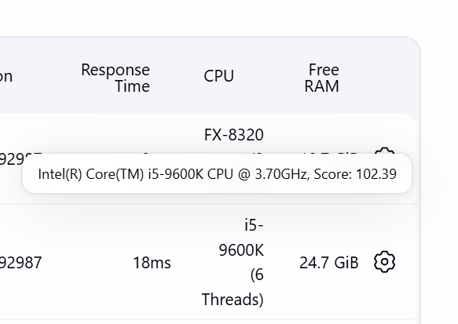
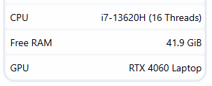

# Specs Monitor

## Introduction

This plugin adds node monitors to the Jenkins node list for **CPU**, **Free RAM** and **GPU**.
The CPU monitor shows the CPU model and the number of hardware threads (logical processors) of every
node (built-in node and agents). This makes it easy to see which agents are fast or slow without opening each machine.
When a CPU matches, the column also shows its median CPU benchmark score from [Blender Open Data](https://opendata.blender.org/benchmarks/query/?compute_type=CPU&blender_version=5.2.0&group_by=device_name).
The bundled `src/main/resources/io/jenkins/plugins/specsmonitor/CpuMonitor/blender_open_data.csv`
contains the Blender device name and median score.

The CPU monitor runs on the node itself, so it reports the hardware of that node. Long vendor
strings such as `13th Gen Intel(R) Core(TM) i9-13900H` are shortened to `i9-13900H`.

Supported operating systems:

- Windows (PowerShell, with a registry fallback)
- Linux (`lscpu`, with `/proc/cpuinfo` as a fallback), including x86, ARM (aarch64) and POWER
- macOS (`sysctl`)

On other systems (for example AIX or Solaris), or if the CPU name cannot be determined, the
monitor shows `N/A`.

## Screenshots

<div align="center">
  <table>
    <tr>
      <td width="50%" align="center">
        
        <br />
        Node list with the CPU and Free RAM columns enabled
      </td>
      <td width="50%" align="center">
        
        <br />
        Example monitor data for a Jenkins node
      </td>
    </tr>
  </table>
</div>

## CPU monitor

A separate monitor, **CPU**, shows the CPU model and the number of hardware threads (logical processors) of every node as a
column, for example `i7-13700K (16 threads)`. When a CPU model matches one in the bundled Blender benchmark dataset,
the column also shows the median benchmark score for that hardware.

## Memory monitor

A second monitor, **Free RAM**, shows the available or free memory (RAM) of every node as a
separate column, for example `15.6 GiB`. Sizes use binary units (1 GiB = 1024 MiB). Hovering over the value shows how much memory
is free out of the total (for example `43.5 GiB free of 63.7 GiB`) at the time of the last refresh. When the value drops below a configurable percentage of the
total (default 10%), it is shown in yellow with a warning symbol. Set the threshold in the
monitor's configuration (`warnBelowPercent` in Configuration as Code).

- Windows: `Win32_ComputerSystem.TotalPhysicalMemory` (PowerShell)
- Linux: `MemTotal` from `/proc/meminfo`
- macOS: `sysctl hw.memsize`
- Other systems and failed lookups: the value reported by the JVM, or `N/A`

The Linux value is the memory the kernel can use, which is slightly less than the installed amount.

## JVM memory monitor

The **Free JVM Memory** monitor shows the free memory of the Java virtual machine running on every
node, for example `1.6 GiB`. Free memory is the maximum heap size minus the heap in use. Hovering
over the value shows how much is free out of the maximum (for example `1.6 GiB free of 2 GiB`) at
the time of the last refresh. When free memory drops below a configurable percentage of the
maximum heap (default 10%), the value is shown in yellow with a warning symbol. Set the threshold
in the monitor's configuration (`warnBelowPercent` in Configuration as Code).

## Uptime monitor

The **Uptime** monitor shows how long the machine of every node has been running since its last boot,
for example `3d 4h`. Hovering over the value shows the full duration. It reads PowerShell on
Windows, `/proc/uptime` on Linux and `sysctl kern.boottime` on macOS. Otherwise, or if the lookup
fails, it shows the uptime of the agent process.

## GPU monitor

The **GPU** monitor shows the first graphics processor model returned by the OS inventory for each
node: Windows Management Instrumentation, `lspci` on Linux, or `system_profiler` on macOS. If the
OS inventory is unavailable, it shows the first result from `nvidia-smi`. Nodes without detectable
GPU information show `N/A`.

## Getting started

1. Install the plugin.
2. Go to **Manage Jenkins → Nodes → Configure Monitors** (gear icon).
3. Enable **CPU**, **Free RAM**, **Free JVM Memory**, **GPU** and/or **Uptime**.
4. A CPU column appears in the node list, for example `i7-13700K (16 threads)`.

### Configuration as Code

```yaml
jenkins:
  nodeMonitors:
    - cpuMonitor
    - memoryMonitor
    - jvmMemoryMonitor
    - gpuMonitor
    - uptimeMonitor
```

## Issues

Report issues and enhancements on the
[GitHub issue tracker](https://github.com/jenkinsci/specs-monitor-plugin/issues).

## Contributing

Refer to the Jenkins
[contribution guidelines](https://github.com/jenkinsci/.github/blob/master/CONTRIBUTING.md).

To try the plugin locally:

```
mvn hpi:run
```

## License

Licensed under MIT, see [LICENSE.md](LICENSE.md).
